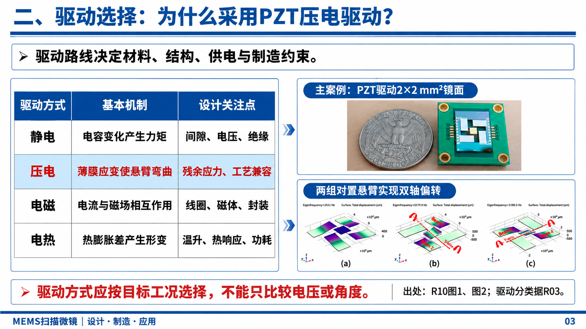
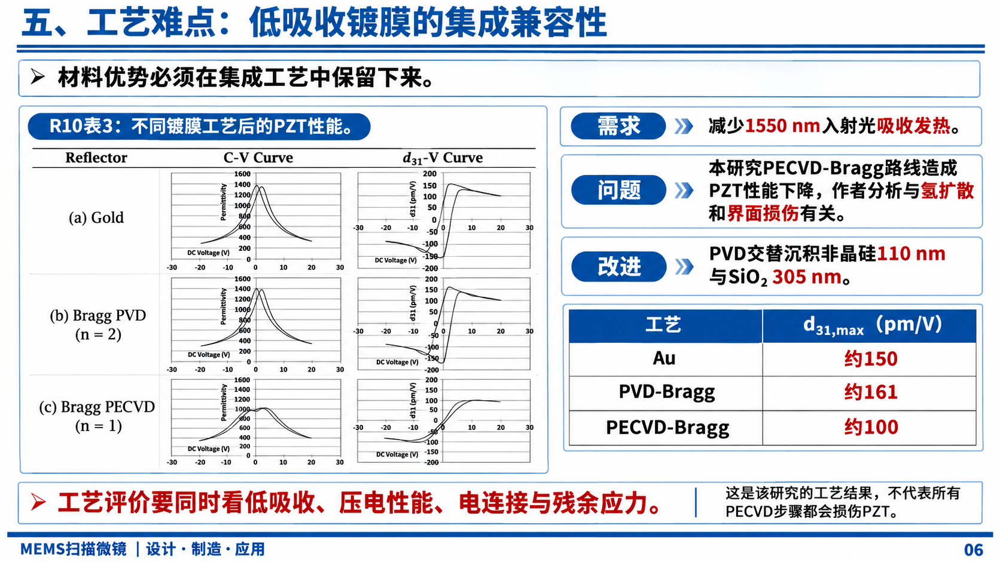
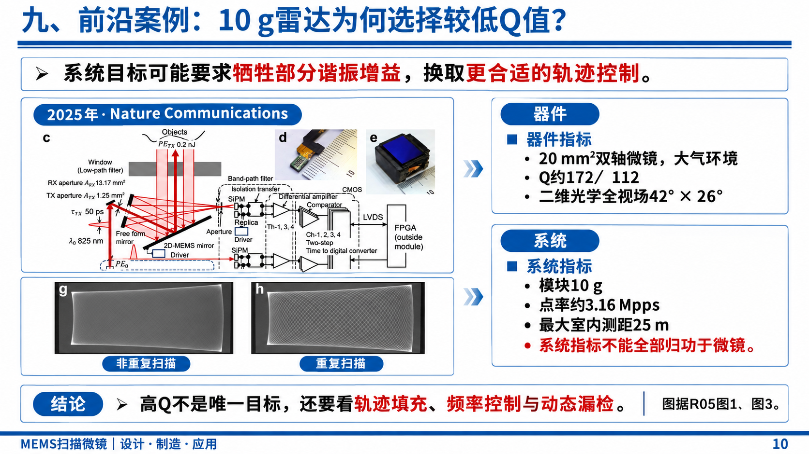

# Paper to Slide Images

**面向文献研究与技术汇报的图片式学术演示文稿生成技能。**

本项目将资料检索、证据核验、文献综合、逐页内容规划、图像生成与 PowerPoint 封装组织为可复用的 Codex 工作流程，适用于课程报告、文献汇报及工程案例分析。

页面主体采用整页图像，以保持复杂图文布局和视觉风格的一致性；封面字段可通过原生文本补充，关键科学图表可通过原图覆盖层嵌入。输出文件为 PPTX，但整页图像中的正文与表格不具备独立编辑能力。

## 效果展示

以下示例选自此前实际生成的《激光雷达 MEMS 扫描微镜》报告正文，展示方案比较、工艺分析与系统应用三种页面组织方式。页面保留实际汇报内容，未包含姓名、班级或学号。

### 方案比较：驱动机制与设计取舍

将驱动方式比较表、器件照片与模态分析图组合呈现，以结论连接比较结果与方案选择。



配图依据：Mollard 等，2023，图 1、图 2；驱动分类参考 Ahmad 等，2024。完整出处见[示例来源](#示例来源)。

### 工艺分析：证据、原因与改进路径

将文献图表与“需求—问题—改进”分析对应组织，同时保留工艺条件与结论适用范围。



配图依据：Mollard 等，2023，表 3。完整出处见[示例来源](#示例来源)。

### 应用案例：器件性能与系统目标

通过系统结构、扫描轨迹和分层指标解释设计权衡，区分器件性能与整机性能。



配图依据：Ohno 等，2025，图 1、图 3。完整出处见[示例来源](#示例来源)。

示例用于展示页面组织与视觉效果。技术内容应依据具体文献、工况与研究目标重新核验，不应直接套用示例结论与数据。

## 工作流程

| 阶段 | 核心工作 | 阶段产物 |
| --- | --- | --- |
| 资料检索与核验 | 阅读用户资料，补充原始研究，核验 DOI、版本及图表出处 | 文献目录、全文资料、来源记录 |
| 综合分析 | 提炼研究主线、方案差异、性能取舍及证据边界 | 文献总结、交叉分析、核心观点 |
| 逐页内容规划 | 确定标题、正文、图表、引用及讲解提示 | 可直接执行的 PPT 大纲 |
| 图表提取与风格确定 | 从原文提取图表，识别参考页面的配色与布局 | 图表素材、来源定位、风格说明 |
| 页面图像生成与修订 | 按页生成，检查文字、公式、箭头、数据及条件 | 页面图片、提示词及版本记录 |
| PPT 封装与资料交付 | 嵌入页面，补充原图覆盖层与备注，渲染检查并整理资料 | PPTX、页面图片、支撑资料包 |

流程支持从已有文献、大纲或页面图片继续执行。总页数由任务决定，约 12 页仅为课程汇报的一种常见配置。

## 安装与使用

### 安装

将完整项目目录放入 Codex 的用户技能目录，保持目录名为 `paper-to-slide-images`。常见位置为 `~/.codex/skills/paper-to-slide-images/`；Windows 对应用户目录下的 `.codex/skills/`。安装后重新载入技能，或开启新的会话。

### 完整报告生成

```text
使用 $paper-to-slide-images，围绕提供的论文制作约 12 页课程汇报。
首先完成文献总结、交叉分析和逐页大纲；大纲确定后，参考所附图片的
视觉风格，使用图像生成工具逐页生成页面，再导入 PPT。
同时整理全部实际使用的支撑资料及来源索引。
```

### 根据已有大纲制作

```text
使用 $paper-to-slide-images，根据现有大纲与文献素材制作 PPT。
沿用参考图的蓝白配色与图文布局，保留科学图表的坐标、单位和来源。
逐页检查生成结果，完成 PPTX 封装与资料包整理。
```

建议提供主题、受众、页数或汇报时长、已有文献、风格参考及提交要求。封面个人信息可按需提供，缺失字段保留为空白或可编辑文本。

## 设计原则

- **以证据组织内容。** 先建立研究主线与逐页观点，再确定视觉表达。
- **保留比较条件。** 区分仿真与实测、器件与系统、设计目标与已验证结果。
- **保证来源可追溯。** 观点、数据和图表关联稳定的来源编号及定位信息。
- **控制图像生成误差。** 核对中文、公式、图例、箭头与数值；关键图表可直接嵌入原始截图。
- **支持阶段续作。** 读取已有素材与记录，避免重复检索或重复生成。

## 脚本与运行环境

| 脚本 | 功能 | 依赖 |
| --- | --- | --- |
| `extract_pdf_assets.py` | 提取 PDF 正文、渲染指定页面并按区域裁图，记录素材来源 | Python 3、PyMuPDF |
| `build_image_deck.mjs` | 将已有页面图片封装为 PPTX，添加原图覆盖层、可编辑文本、备注与来源，并渲染验证 | Node.js、Codex Artifact Tool、本地演示文稿技能及其运行依赖 |
| `package_sources.py` | 按实际使用资料生成来源索引、校验记录与可独立解压的分包 | Python 3 标准库 |

页面生成使用当前 Codex 环境中可用的内置图像生成工具。仓库脚本负责素材处理与封装，不直接调用图像生成 API，不自动安装依赖。PPT 构建脚本依赖 Codex 演示文稿运行时，不是脱离该环境的独立转换器。

脚本参数、输入清单及调用示例见 [references/manifests.md](references/manifests.md)。

## 目录结构

```text
paper-to-slide-images/
├── SKILL.md                       # 技能入口与执行流程
├── agents/openai.yaml             # Codex 技能界面配置
├── assets/examples/               # 实际生成的报告页面示例
├── references/
│   ├── evidence.md                # 来源记录与证据边界
│   ├── image-prompts.md           # 页面生成与定点修订提示词
│   └── manifests.md               # 脚本输入格式与使用说明
├── scripts/
│   ├── extract_pdf_assets.py
│   ├── build_image_deck.mjs
│   └── package_sources.py
├── LICENSE
└── README.md
```

报告任务建议分别保存 `sources/`、`analysis/`、`figures/`、`slides/`、`build/` 与 `deliverables/`，与公开技能文件分开管理。

## 验证情况与适用边界

已使用合成测试资料验证 PDF 提取、无效裁剪参数拒绝、资料分包完整性及缺失来源检测；已实际构建两页测试 PPTX，检查图片嵌入、原图覆盖层、可编辑文本、来源备注及重新导入。技能结构已通过校验。上述检查不等同于所有环境下的兼容性保证，也不替代最终的逐页视觉审阅。

本流程适合重视版式一致性和图文呈现的学术报告。需要逐项编辑正文、表格、图形或动画时，应采用原生对象为主的演示文稿制作流程。

## 示例来源

示例页面中的 `R03`、`R05`、`R10` 为原报告的文献编号，仅用于保留页面出处，不是本技能的固定编号规则。

| 编号 | 文献 | 示例使用位置 |
| --- | --- | --- |
| R03 | Ahmad, Bahri and Sawan. *MEMS Micromirror Actuation Techniques: A Comprehensive Review of Trends, Innovations, and Future Prospects*. Micromachines, 2024. [DOI: 10.3390/mi15101233](https://doi.org/10.3390/mi15101233) | 驱动分类背景 |
| R10 | Mollard et al. *Biaxial Piezoelectric MEMS Mirrors with Low Absorption Coating for 1550 nm Long-Range LIDAR*. Micromachines, 2023. [DOI: 10.3390/mi14051019](https://doi.org/10.3390/mi14051019) | 驱动案例图 1、图 2；工艺分析表 3 |
| R05 | Ohno et al. *Super-dense point clouds acquired by an ultralight 10 g solid-state single photon LiDAR*. Nature Communications, 2025. [DOI: 10.1038/s41467-025-67346-8](https://doi.org/10.1038/s41467-025-67346-8) | 系统应用案例图 1、图 3 |

示例页面由图像生成工具结合文献素材制作，包含版式编排、文字归纳与图表再呈现。科学细节以原始文献为准；示例图片不替代原始数据或原文图表。

## 许可与资料管理

项目代码与自有文档采用 [MIT License](LICENSE)。示例中的第三方论文图表及其衍生呈现不因本仓库的 MIT 许可而重新授权，使用时应遵循原文许可、署名要求及具体素材的权利说明。

公开目录仅保留技能文件与选定的正文展示图片，不包含报告封面、个人身份信息、论文全文或私有任务记录。示例 PNG 的附加元数据已移除。
